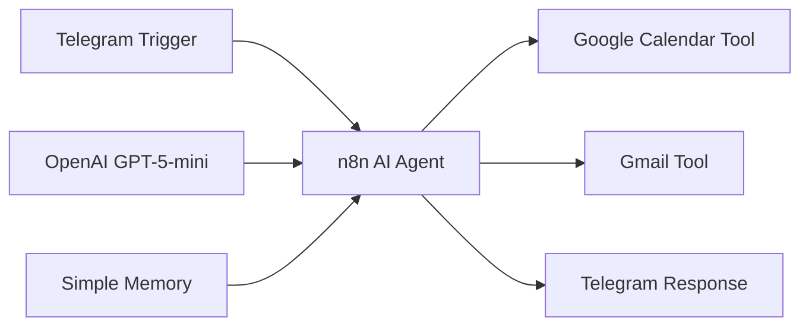

# Architecture

## Components

| Component | Role |
|---|---|
| Telegram Trigger | Receives the user's natural-language request |
| n8n AI Agent | Interprets the request and selects tools |
| OpenAI GPT-5-mini | Provides the language-model reasoning layer |
| Simple Memory | Maintains conversational context |
| Google Calendar Tool | Creates calendar events |
| Gmail Tool | Sends emails |
| Telegram Response | Returns the completed result to the user |
